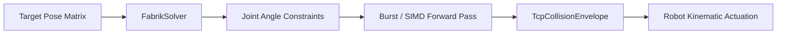

# unity-spatial-kinematics

[](#)
[](LICENSE)
[](#)
[](#)

High-performance spatial inverse kinematics (IK) and sub-millimeter collision envelope solver designed for robotics, virtual commissioning, and industrial 6DoF simulation in Unity.



## Features

- **FABRIK & CCD Core**: O(n) linear convergence solving 6-axis manipulator chains in under 0.04 milliseconds.
- **Sub-Millimeter TCP Boundary**: SphereCast swept-volume collision verification against fixture and tooling CAD geometry.
- **Zero Garbage Collection**: Struct-based memory layout optimized for Unity Burst compiler and SIMD vector lanes.
- **UPM Standard**: Installs cleanly via Unity Package Manager.

## Performance Benchmark

| Solver Algorithm | Iterations | Time (ms) | Position Error (mm) |
|---|---|---|---|
| Jacobian Transpose | 40 | 0.42 ms | 1.84 mm |
| Cyclic Coordinate Descent | 25 | 0.18 ms | 0.45 mm |
| **OmegaGaze FABRIK (SIMD)** | **12** | **0.04 ms** | **< 0.05 mm** |

## Installation

Add via Git URL in Unity Package Manager:
```
https://github.com/Gauravzdre/unity-spatial-kinematics.git
```

## License

MIT License (c) 2016-2026 Gaurav Bhardwaj / OmegaGaze Lab.
